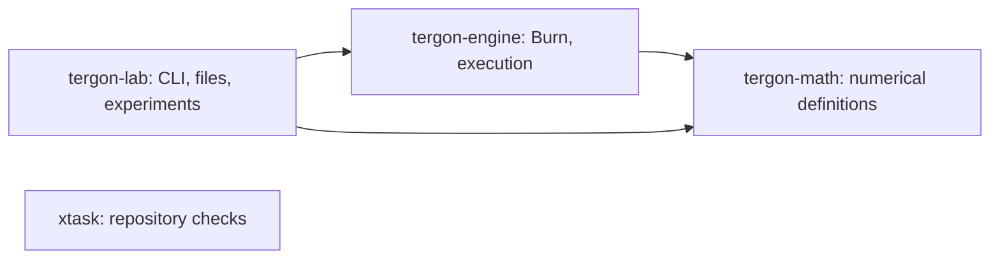

# Architecture

The runtime has three crates. Developer checks live in a fourth workspace member.

| Crate | Owns | Boundary |
| --- | --- | --- |
| tergon-math | QuantSpec, PackedTernary, scalar definitions | Standard library only; no tensor backend, files, processes, or networking |
| tergon-engine | PlacementPlan, Burn tensor bridge, trainable ternary layer; later optimizers | No external I/O; no implicit device fallback |
| tergon-lab | CLI, RunManifest receipts; later datasets, checkpoints, reports | All external I/O belongs here |
| xtask | Architecture, evidence, documentation, contribution checks | Never a runtime dependency |

Packed weights are immutable inference values. Future trainable latent weights
are floating-point parameters with a separate lifecycle. Experiment metadata is
neither a tensor nor model state. An optimizer must not silently move tensors
between host and GPU or turn packed values into mutable training state.

The initial bridge decodes on CPU then creates a Burn f32 tensor on an explicitly
requested device. This allocates buffers; it is not a packed kernel or zero-copy
path. Default execution is Flex CPU. `cuda` is a compile-time opt-in and runtime
device selection is explicit. A missing backend is an error, never a fallback.

Later seams are an optimizer and versioned checkpoint I/O.
Add them when their consumers exist. Prefer functions and concrete data types
until multiple implementations or a test seam justify a trait.

Closure theory remains relevant to the archived symbolic learner: finite,
monotone Horn inference reaches a least fixed point. It does not prove neural
training convergence, prediction quality, or efficient inference. A future
symbolic adapter needs its own measured task and interface proposal.
