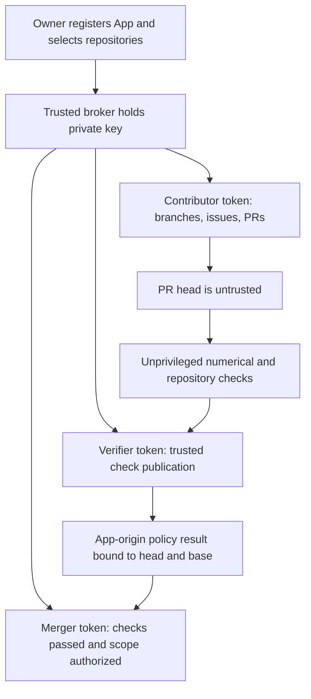

# GitHub App setup

The repository can use the same App across selected repositories and different
agent clients. The private key remains in a trusted token broker. Agents get only
short-lived repository-scoped installation tokens.

The App has not been registered or installed by this implementation. The existing
cloud credential identifies as the owner and cannot validate agent isolation.
Until acceptance tests pass, every PR needs owner approval and scoped merging is
disabled in policy/agent-scopes.json.

## Owner registration

1. Open GitHub Settings → Developer settings → GitHub Apps → New GitHub App.
   Choose a unique name such as `tergon-lab-automation`; the App name may serve
   other repositories too. Set this repository as its homepage. A polling broker
   does not need a public webhook endpoint, so disable webhooks initially.
2. Request repository permissions: Contents read/write, Pull requests read/write,
   Issues read/write, Checks read/write, Actions read, Metadata read. Do not grant
   Administration, Workflows, Secrets, or bypass rights. Declare the App private
   if only your account/organization needs to install it.
3. Install on selected repositories only, initially tergon-lab. Record App ID and
   installation ID. Generate a private key and place it directly in the broker's
   secret store. Never paste it in chat, commit it, or mount it in an agent session.
4. The broker signs a short-lived App JWT and calls
   `POST /app/installations/{installation_id}/access_tokens`, explicitly narrowing
   `repository_ids` and `permissions` for the requested role. Use GitHub's maintained
   SDK or token action; do not implement custom crypto in the model runtime.

## Token profiles

The machine-readable request profiles are in policy/app-token-profiles.json.

| Role | Allowed work | Must not receive |
| --- | --- | --- |
| Contributor | Create branch commits, issues, PRs in the selected repo | checks:write, private key, admin or workflow permission |
| Verifier | Read PR and Actions state, publish trusted checks | Agent code execution with its token; contents:write |
| Merger | Inspect exact head/base and merge authorized PRs | Private key exposure to contributors; ruleset bypass |

Installation tokens normally expire after one hour. A broker renews them before
expiry, records issuance metadata without the token, and revokes them when the
task ends. Revoke/rotate the key and installation on suspected exposure. Do not
assume a fixed token prefix or length. Never give an unrestricted installation
token to an agent merely because its intended task is narrow.

All profiles share an App identity. GitHub's expected-App check source does not
distinguish them; the broker must enforce token-profile isolation. For stronger
operational separation, use distinct contributor and verifier Apps. There is no
broker implementation in this model repository yet.

## Trust and merge rules

The current trusted-policy workflow runs from the base branch, executes no PR code,
and uses an owner-review environment. Configure that environment with kmosoti as
required reviewer, administrative bypass disabled, and self-review permitted for
the solo owner. Its final step rechecks exact head and base after approval. A new
head cancels the old run; strict up-to-date checks require refreshing a changed base.
GitHub Actions check-source pinning alone cannot distinguish two workflows with
the same check name. Until the separate App verifier is active, the main ruleset
also requires one code-owner review. This conservative bootstrap rule prevents
a contributor from authorizing a merge by spoofing an Actions check name.

GitHub does not let an author approve their own PR. The initial foundation PR is
owner-authored with the current cloud credentials. After installing the App,
reopen its unchanged branch as an App-authored PR so the owner can review it;
preserve the original PR link and commits. Do not weaken the rule to work around
that identity limitation. The App-authored PR is also a useful first isolation test.

The later verifier must read scope authorization from main, never the PR's copy.
It must verify code/config/evidence check results, required GPU receipts, current
head/base, and protected-change classification. Only then may it publish the
required policy check through the App. Pin the ruleset's expected check source to
that App. A label or successful contributor-created status is not authority.

Use a main ruleset with PR-only changes, strict required checks, resolved review
threads, linear history, no force pushes/deletion, and no agent bypass. Squash
merges and delete completed branches. Owner approval remains required for protected
changes even after routine scopes become eligible. GitHub Wiki edits use a separate
repository and are not protected by main's ruleset.

## Acceptance before enabling scoped merges

Use a disposable test repository with the same rules and App installation.
Record expected denials as well as successes:

1. Contributor cannot push to main, force-push main, or delete it.
2. Contributor cannot publish the trusted App check or obtain verifier credentials.
3. Editing a workflow, numerical oracle, tolerance, dependency, or scope does not
   make that PR eligible for self-approval.
4. A check on an earlier head or base cannot authorize the current merge.
5. A PR outside its main-approved issue/file scope, or above 300 handwritten
   changed lines, requires owner approval. Renames, deletions, and generated-file
   exemptions cannot hide protected changes.
6. An eligible scoped PR can merge only after all required checks pass; an
   owner-only PR also requires recorded approval tied to the current revision.
7. Token expiry, revocation, and installation removal stop access as expected.

Publish the receipt and implement the trusted scoped classifier/merger in a
separate reviewed change. Do not enable the flag until those checks are real.
